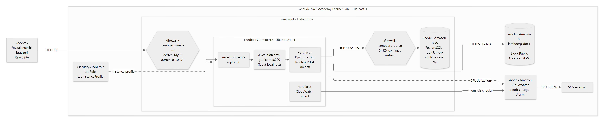

# Lamborghini ERP

Lamborghini dilerlik markazlari tarmog'i uchun ERP tizimi: filiallar, avtomobillar sotuvi, ehtiyot qismlar ombori,
avtoservis, xodimlar maoshi va KPI, analitika hamda hujjatlar (invoice PDF) — bitta veb-ilovada.

🌐 **Jonli versiya:** https://absolutelydeveloper.uz
(AWS: EC2 + RDS PostgreSQL + S3 + CloudWatch)

---

## Imkoniyatlar

| Rol | Nima qila oladi |
|---|---|
| **Bosh Boshqarma** (`top_management`) | Barcha filiallar analitikasi, filiallar, xodimlar va maoshlar, KPI rejalari, ombor, buyurtmalar, hujjatlar |
| **Sotuv menejeri** (`sales_manager`) | Avtomobil sotuvi Kanban pipeline'i, avtomobillar katalogi, invoice, o'z KPI'i |
| **Omborchi** (`warehouse_manager`) | Ombor qoldiqlari, kirim/chiqim, kam qolgan detallar, buyurtmalar |
| **Servis ustasi** (`service_master`) | Ta'mirlash kartochkalari, ehtiyot qismlar, o'z KPI'i |

- Har bir xodim faqat **o'z filiali** ma'lumotlarini ko'radi (RBAC).
- Buyurtma yaratilganda ombordagi qoldiq avtomatik band qilinadi, bekor qilinsa qaytariladi.
- Buyurtma uchun **invoice PDF** yaratiladi va **Amazon S3**'da saqlanadi.
- KPI: oylik reja (daromad 70% + buyurtmalar soni 30%) va natija asosida bonus.

## Texnologiyalar

| Qism | Texnologiya |
|---|---|
| Backend | Python 3.12, Django 6.1, Django REST Framework, SimpleJWT |
| Frontend | React 19, Vite, TailwindCSS, Recharts, Axios |
| Ma'lumotlar bazasi | PostgreSQL (Amazon RDS); lokal ishlashda SQLite |
| Fayllar | Amazon S3 (`django-storages`, `boto3`), PDF — ReportLab |
| Server | nginx + gunicorn (systemd), Let's Encrypt HTTPS |
| Monitoring | Amazon CloudWatch (metrikalar, loglar, alarm), `/api/health/` |

## Arxitektura

```
Foydalanuvchi ──HTTPS──▶ EC2 (nginx → gunicorn → Django + React build)
                          ├─▶ RDS PostgreSQL  (faqat EC2 security group'idan, SSL)
                          ├─▶ S3              (yopiq bucket, IAM role orqali — access key'siz)
                          └─▶ CloudWatch      (CPU/RAM/disk, ilova va nginx loglari)
```

UML diagrammalar: [docs/uml](docs/uml) · Texnik hisobot: [docs/HISOBOT.md](docs/HISOBOT.md)



## Lokal ishga tushirish

Talablar: Python 3.12+, Node.js 20+.

```bash
git clone https://github.com/erkinov0117d/lamboerp.git
cd lamboerp

python -m venv .venv
# Windows: .venv\Scripts\activate    Linux/macOS: source .venv/bin/activate
pip install -r requirements.txt

python manage.py migrate
python manage.py seed_db        # filiallar, avtomobillar, buyurtmalar, 20 ta xodim (parolni chiqaradi)
python manage.py seed_staff     # xodimlar sonini 100 taga yetkazadi
python manage.py runserver      # http://127.0.0.1:8000
```

Frontend'ni ishlab chiqish rejimida (alohida terminalda):

```bash
cd frontend
npm install
npm run dev                     # http://localhost:5173 (/api → Django'ga proxy)
```

Frontend o'zgargach production build: `npm run build` — natija `frontend/dist` ga yoziladi va Django uni o'zi beradi.

Testlar: `python manage.py test erp`

## Demo foydalanuvchilar

Lokal ishga tushirganda parol `seed_db` buyrug'i oxirida chiqariladi.
Jonli saytga kirish uchun loyiha muallifiga murojaat qiling.

| Login | Rol |
|---|---|
| `ceo`, `admin` | Bosh Boshqarma |
| `sales_tas`, `sales_dxb`, `sales_mil` | Sotuv menejeri (Toshkent / Dubay / Milan) |
| `warehouse_tas`, `warehouse_dxb`, `warehouse_mil` | Omborchi |
| `service_tas`, `service_dxb`, `service_mil` | Servis ustasi |

## Sozlamalar (`.env`)

Lokal ishlash uchun `.env` shart emas (SQLite va `media/` papkasi ishlatiladi).
Serverda namunalar: [`.env.example`](.env.example), [`deploy/aws/.env.aws.example`](deploy/aws/.env.aws.example).

| O'zgaruvchi | Vazifasi |
|---|---|
| `DJANGO_SECRET_KEY`, `DJANGO_DEBUG`, `DJANGO_ALLOWED_HOSTS` | Django asosiy sozlamalari |
| `DJANGO_SECURE_COOKIES` | HTTPS bo'lsa `True` |
| `DB_HOST`, `DB_NAME`, `DB_USER`, `DB_PASSWORD`, `DB_SSLMODE` | Berilsa — PostgreSQL (RDS), aks holda SQLite |
| `AWS_STORAGE_BUCKET_NAME`, `AWS_S3_REGION_NAME` | Berilsa — fayllar S3'da, aks holda `media/` |

## Deploy

- AWS (EC2, RDS, S3, CloudWatch): [AWS_DEPLOY.md](AWS_DEPLOY.md)
- AWS Academy Learner Lab: [AWS_ACADEMY.md](AWS_ACADEMY.md)
- PythonAnywhere: [DEPLOY.md](DEPLOY.md)

Serverda kodni yangilash: `bash deploy/aws/update.sh`

## Loyiha tuzilmasi

```
core/            Django sozlamalari va URL'lar
erp/             Modellar, API (DRF), biznes-logika, KPI, invoice, management buyruqlari
frontend/        React ilova (src/) va production build (dist/)
deploy/aws/      EC2 o'rnatish skripti, nginx, gunicorn, CloudWatch, IAM/S3 policy'lar
docs/            Texnik hisobot, UML diagrammalar, texnik topshiriq
```
