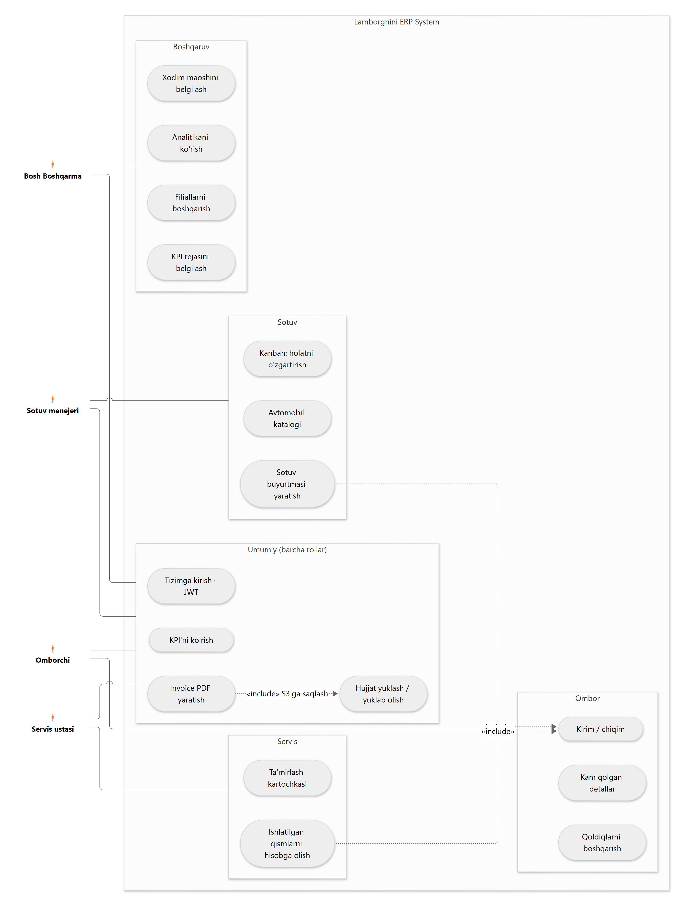
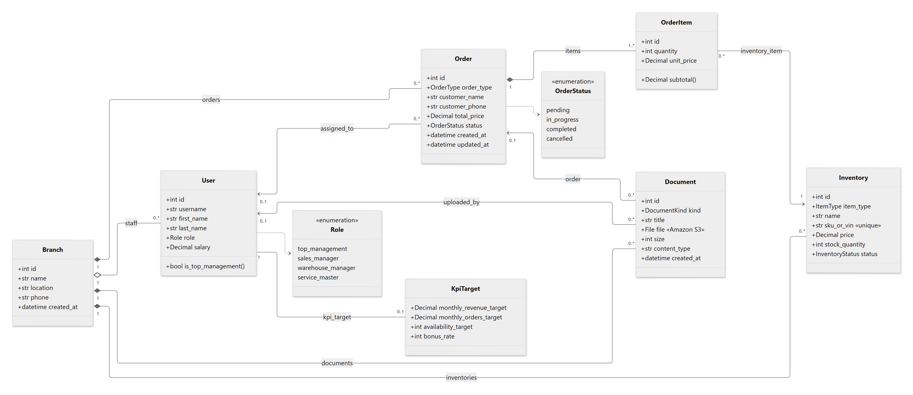
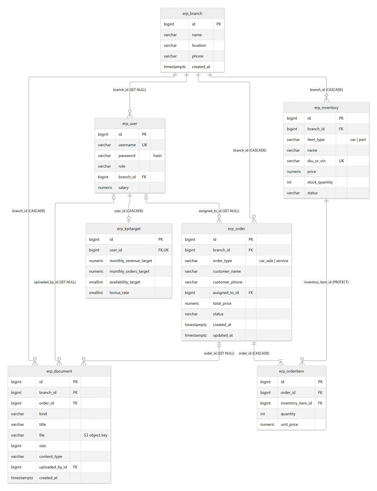
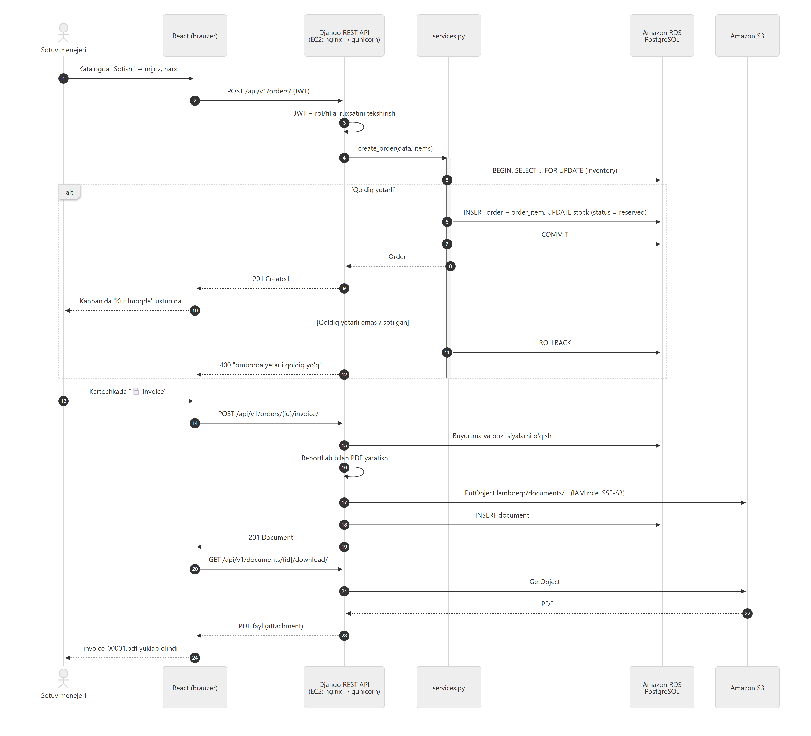
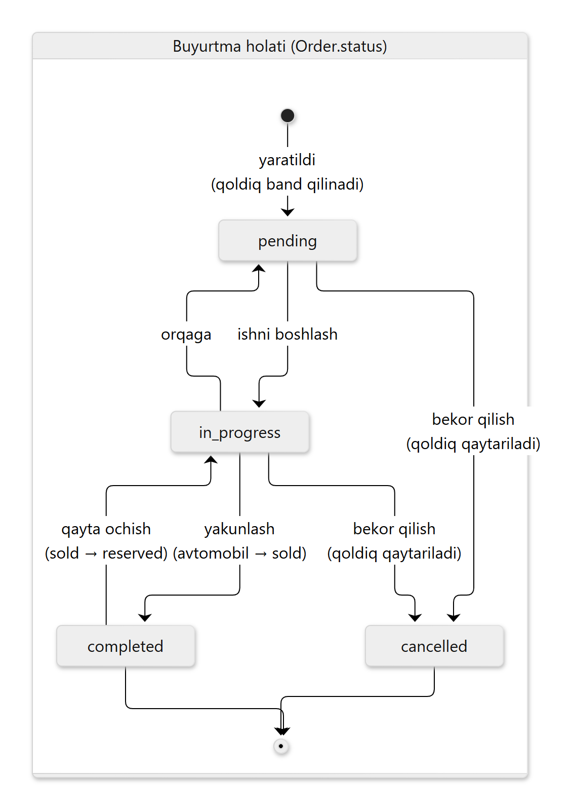
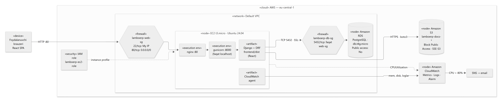

# Lamborghini ERP — UML diagrammalar

Har bir diagrammaning manbasi `docs/uml/*.mmd` (Mermaid), tayyor rasmlari `*.png` va `*.svg`.
Manbani o'zgartirib, https://mermaid.live saytida ko'rish yoki rasmga eksport qilish mumkin.

## 1. Use case diagrammasi

Tizimning 4 ta aktyori (rol) va ular bajaradigan amallar. Har bir rol o'z modulidagi amallarni va
"Umumiy" bo'limdagi amallarni bajaradi. Sotuv va servis buyurtmalari ombor qoldig'ini avtomatik
o'zgartiradi (`«include» Kirim / chiqim`), invoice esa S3'ga hujjat sifatida saqlanadi.

## 2. Klasslar diagrammasi

Django modellari (`erp/models.py`), atributlari va bog'lanishlari.
◆ — kompozitsiya (filial o'chirilsa, ombori, buyurtmalari va hujjatlari ham o'chadi),
◇ — agregatsiya (xodim filialsiz qolishi mumkin), raqamlar — multiplicity.

## 3. ER diagramma (Amazon RDS PostgreSQL)

Ma'lumotlar bazasi jadvallari, birlamchi (PK), tashqi (FK) va noyob (UK) kalitlar hamda
o'chirish qoidalari (`CASCADE`, `SET NULL`, `PROTECT`). `erp_document.file` — Amazon S3'dagi obyekt kaliti.

## 4. Ketma-ketlik diagrammasi: sotuv buyurtmasi va invoice

Sotuv menejeri avtomobil sotganda: JWT va rol tekshiruvi → tranzaksiya ichida qoldiqni bloklash
(`SELECT ... FOR UPDATE`) → buyurtma yaratish yoki rad etish. Keyin invoice PDF yaratilib,
IAM role orqali Amazon S3'ga yoziladi va foydalanuvchiga yuklab beriladi.

## 5. Holatlar diagrammasi: buyurtma

Buyurtma holatlari va o'tishlar. Har bir o'tish ombor holatini ham o'zgartiradi
(qoldiq band qilinadi / qaytariladi, avtomobil `sold` bo'ladi).

## 6. Deployment diagramma (AWS)

Ilova komponentlarining bulut infratuzilmasida joylashuvi: EC2 (nginx → gunicorn → Django),
Amazon RDS, Amazon S3, CloudWatch, Security Group'lar va IAM role.

